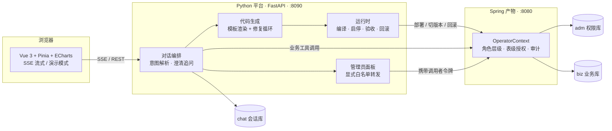

<div align="center">

# SysCraft · 语构

**把一段自然语言需求，变成一套可编译、可运行、自带鉴权的 Spring 业务系统**

*用语言构建系统 —— craft a system by talking*

[](https://github.com/AmiroKD/syscraft/actions/workflows/ci.yml)


</div>

---

**SysCraft（语构）** 是一个平台（Python）常驻的系统：它理解你的需求、生成代码、编译部署；
Spring 是被它生成出来的**产物**，可整体重建、可回滚。

- **语构**：用语言构建系统。
- **SysCraft**：craft a system by talking。

## 目录

- [功能特性](#-功能特性)
- [架构](#%EF%B8%8F-架构)
- [仓库结构](#-仓库结构)
- [快速开始](#-快速开始)
- [跑测试](#-跑测试)
- [前端与演示模式](#%EF%B8%8F-前端与演示模式)
- [使用指南](#-使用指南)
- [暂停与刷新恢复](#%EF%B8%8F-暂停与刷新恢复)
- [开发约定](#-开发约定)
- [License](#-license)

## ✨ 功能特性

- 🗣️ **对话生成整套系统** —— 一条流水线：渲染模板 → 建表 → 编译（失败自动进修复循环）→ 启动 → 默认授权 → 自动验收 → 版本登记，**任何一步失败自动回滚**
- ➕ **一句话加字段** —— 「给活动加一个备注字段」：出计划 → 确认 → `ALTER TABLE` → 新版本重渲染 → 编译 → 上线 → 自动验收，失败同样回滚
- 🔐 **三库分离的安全模型** —— `adm`（权限）、`biz`（业务）归产物，`chat`（会话）归平台；平台账号只授权 `chat.*`，越权写权限库会被 MySQL 直接拒绝
- 🛡️ **管理员面板** —— 账号 / 角色 / 表级授权走专用界面，链路显式白名单转发；权限操作刻意不接进对话——高危操作的守门人是带角色校验的界面，不是一条会听话的模型链路
- 📡 **SSE 流式 + 暂停 + 刷新恢复** —— 回答途中可暂停；页面刷新后事件流按 `seq` 续传接管，刷新不等于重发
- 🔁 **修复循环** —— 编译失败不是失败：模板渲染的代码进 RepairLoop 自动修，修不动才报错
- 🎨 **Vue 3 前端** —— 工具调用轨迹、表格、图表（自动推断维度/度量）、生成进度全部卡片化；构建产物随仓库提交，不装 Node 也能跑
- 🎬 **演示模式** —— `?demo=1` 不连后端渲染全部卡片类型，答辩现场没有产物/Key 也能演示
- ✅ **220 个单元测试** —— GitHub Actions 全绿，测试固定打 `chat_test` 库，绝不清真实数据

## 🏗️ 架构



**三份存储各归各的**：`adm`（权限）、`biz`（业务）归产物，`chat`（会话）归平台。
平台账号只授权 `chat.*`——越权写权限库会被 MySQL 直接拒绝。

Spring 管状态（`adm_state.current_version`），平台管进程——状态与进程归属单一，
两边不会各记一份「现在跑的是哪个版本」。

## 📁 仓库结构

```
code/
├── agent-platform/        # Python 平台：对话、解析、生成、运行时
│   ├── src/syscraft/
│   │   ├── conversation/  # 双模式状态机、SSE 事件流
│   │   ├── requirement/   # 需求解析、澄清追问、ModelDiff
│   │   ├── codegen/       # 模板渲染 + RepairLoop
│   │   ├── runtime/       # 编译、启停、验收、回滚
│   │   ├── tools/         # 四组工具、路径沙箱
│   │   └── prompt/
│   ├── templates/         # 代码模板（修复循环不可写）
│   ├── tests/
│   ├── web/               # Vue 3 前端：src 源码 + dist 构建产物（由平台托管）
│   └── workspace/         # 运行期产物（不进版本库；会话不再落这里）
└── spring-skeleton/       # Java 固定骨架：platform/ 96 个类
    └── src/main/java/com/generated/platform/
```

## 🚀 快速开始

### 环境要求

| 依赖 | 版本 | 何时需要 |
|---|---|---|
| Python | 3.12 | 平台运行时（必须） |
| MySQL | 8.0 | 会话库 / 权限库 / 业务库（必须） |
| Node.js | ≥ 18 | 仅改前端源码时需要（构建产物已随仓库提交） |
| Java + Maven | Java 21 | 仅生成 / 运行产物时需要 |
| LLM API | 任一 OpenAI 兼容服务 | 对话与生成（登录后在设置页填写） |

### 1. 安装平台依赖

```bash
git clone https://github.com/AmiroKD/syscraft.git
cd syscraft/agent-platform

uv venv --python 3.12
uv pip install -r requirements.lock --python .venv/bin/python
```

> 依赖分两份：`requirements.txt` 只写意图（允许升级），`requirements.lock` 锁死补丁版本
> （答辩/复现按这份装，行为才可重复）。

### 2. 配置数据库凭证

凭证不进仓库，放本地文件（默认 `~/.adaptive/db.env`，`set -a` 导出后子进程才读得到）：

```bash
# ~/.adaptive/db.env —— 最小启动集
MYSQL_ROOT_PWD=...          # MySQL root 密码（仅建库脚本用）
ADMIN_USER=admin            # 平台管理员账号
ADMIN_INIT_PWD=...          # 初始密码（首次登录强制修改）
APP_USER=app                # 产物数据源账号
APP_PWD=...                 # 产物数据源密码
JWT_SECRET=...              # 产物 JWT 签名密钥
APP_SECRET=...              # 产物加密密钥
MCP_USER=mcp                # 工具链连库账号
MCP_PWD=...
CHAT_DB_HOST=127.0.0.1
CHAT_DB_PORT=3306
CHAT_DB_NAME=chat
CHAT_DB_USER=chat
CHAT_DB_PASSWORD=           # 留空，由下一步的脚本自动生成
```

```bash
set -a; source ~/.adaptive/db.env; set +a   # 少了 set -a，Java 读不到 APP_PWD
```

### 3. 初始化会话库

```bash
./scripts/init_chat_db.sh    # 建 chat / chat_test + 只授权这两库的 chat 账号（幂等）
```

### 4. 启动平台

```bash
PYTHONPATH=src .venv/bin/python -m uvicorn syscraft.app:app --host 127.0.0.1 --port 8090
```

浏览器打开 `http://127.0.0.1:8090`——到此就能登录、看界面、进演示模式；
要**生成并运行自己的系统**，再装 Java 21 + Maven，然后看[一次完整生成](#一次完整生成一条命令)。

## 🧪 跑测试

```bash
set -a; source ~/.adaptive/db.env; set +a    # 测试要用 chat_test
PYTHONPATH=src .venv/bin/python -m pytest -q
```

测试固定打 `chat_test`（`tests/conftest.py` 强制），库名不以 `_test` 结尾直接拒绝清表。

## 🖥️ 前端与演示模式

界面是独立的 Vue 工程，源码在 `agent-platform/web/`，构建产物在 `web/dist/`：

```bash
cd agent-platform/web
npm install
npm run build      # 产出 web/dist，FastAPI 的 / 与 /assets 直接托管
```

- **构建产物随仓库提交**，所以只有 Python 环境、不装 Node 也能直接起服务看界面；
  改了前端源码要重新 `npm run build`，否则页面还是旧的；
- `npm run dev` 起 Vite（5173），`/api` 代理到 8090，改样式时热更新更方便。

结构：`src/lib/`（请求、SSE、Markdown、列格式化、图表推断）、`src/stores/`
（auth / chat / event / settings / ui）、`src/components/`（20 个单文件组件）。
表格与图表是同一张卡片的两个视图——数据只有一份，看法可以切换。

> 🎬 **不看后端也能看界面**：开 `http://127.0.0.1:8090/?demo=1`，会用一份示例会话
> 渲染工具调用轨迹、表格、图表、生成计划与生成进度。

## 📖 使用指南

### 一次完整生成（一条命令）

```bash
cd agent-platform

# 一条命令：停旧产物 → 渲染 → 建表 → 编译（失败进修复循环）→ 启动
#           → 模型快照 → 默认授权 → 自动验收 → 版本登记 → 失败自动回滚
PYTHONPATH=src .venv/bin/python -m syscraft.runtime.pipeline --model models/trade_order.v1.json
```

生成器拒绝覆盖已存在的版本目录：换 `model_version` 或先手工删除。

只跑渲染（不碰数据库、不编译）：

```bash
PYTHONPATH=src .venv/bin/python -m syscraft.codegen.generator --model models/trade_order.v1.json
```

Maven 按 `mvn`（PATH）→ `MAVEN_HOME` → `~/.m2/wrapper` 三级定位，不依赖某台机器的哈希目录。

### 增量修改（加字段）

在对话里直接说，例如：

```
给活动加一个备注字段
```

系统会先出一份计划（列名/类型/是否可空），回复「确认生成」后执行：
`ALTER TABLE 加列 → 新版本重渲染 → 编译 → 上线 → 自动验收`，失败自动回滚旧版本。

- 只支持**加列**（`ADD COLUMN ... NULL DEFAULT NULL`，对存量数据零影响）；
  删列、改类型、改名不在最小演化范围内——它们不可逆，需要专门的数据迁移设计；
- 新字段一律可空；列名冲突时用字母后缀（`remark_b`），不用数字——
  数字后缀的 property 还原不回列名（`remark_2` → `remark2`），会让整个实体查询 500；
- 计划文件是 `models/plan.{id}.json`，确认时才分配版本号并转正为 `auto_gen.vN.json`。

### 更换模型 / 自定义接入

登录后左下角用户菜单 →「设置 → 模型服务」可以自行填写：

- **API Base URL**：填到 `/v1` 为止，平台自动拼接 `/chat/completions`；
- **API Key**：由用户填写，表单内容缓存在当前浏览器；保存后写入
  `~/.adaptive/llm-settings.json`（权限 600，与 db.env 同目录）供平台调用。
  读取接口只返回「是否已配置」，不回传 URL / Key / 模型；
- **模型名**：完全自由填写，没有预置清单或默认值，按你的服务商文档填模型 ID 即可。

表单默认空白起步，不用服务端环境变量回填——填过的内容保存在当前浏览器
（localStorage），下次打开自动恢复；公共电脑可用「清除本机缓存」清掉。
建议先点「测试连接」（最小补全，验证 URL / Key / 模型是否真的可用），再「保存并应用」。
保存后对对话、生成、修复循环全局生效，不需要重启平台。

### 账号管理（管理员面板）

登录后左下角用户菜单 →「账号管理」（仅 SUPER_ADMIN / ADMIN 可见）。三个页签：

- **账号**：搜索/筛选用户，创建账号（初始密码可一键随机生成）、改角色、
  停用/启用、重置密码——新初始密码**只展示一次**，复制后通过安全渠道交给本人，
  首次登录会强制改密；
- **角色**：内置角色（超管 100 / 管理员 50 / 普通用户 10）与能力声明，只读——
  层级是结构不是配置，只能管理比自己层级低的账号（产物侧强制）；
- **表级授权**：按「角色或用户 × 实体表」逐条授予 READ / READ_WRITE / FULL，
  可设过期时间；刻意没有批量端点（授权是最容易被一句话打穿的面），逐条加、逐条撤。

链路：前端 → 平台 `/api/admin/*`（显式白名单转发，携带调用者自己的令牌）→ 产物
`OperatorContext` 做能力校验（MANAGE_USER、层级不可越权）与审计落 `adm_audit`。
平台不复制权限模型，只把入口收窄到管理员；权限操作刻意不接进对话——
高危操作的守门人是带角色校验的专用界面，不是一条会听话的模型链路。

### 冒烟自检

```bash
./scripts/smoke.sh                  # 健康 → 登录 → 版本清单 → 一次只读查询
./scripts/smoke.sh "查一下活动"      # 换一句只读问题
```

退出码非 0 即冒烟失败，答辩前跑一遍比人工点页面可靠。

### 对话链路（API 速览）

```bash
# 终端 A：产物侧（已编译好的 v1）
cd agent-platform/workspace/versions/v1
env -u SERVER__PORT java -jar target/syscraft-skeleton-0.1.0.jar --server.port=8080

# 终端 B：平台侧
cd agent-platform
PYTHONPATH=src .venv/bin/python -m uvicorn syscraft.app:app --host 127.0.0.1 --port 8090

# 登录拿令牌，再发一句话
set -a; source ~/.adaptive/db.env; set +a
TOKEN=$(curl -s -X POST localhost:8090/api/auth/login -H 'Content-Type: application/json' \
  -d "{\"username\":\"$ADMIN_USER\",\"password\":\"$ADMIN_INIT_PWD\"}" \
  | python3 -c 'import sys,json;print(json.load(sys.stdin)["data"]["token"])')

curl -s -X POST localhost:8090/api/chat -H "Authorization: Bearer $TOKEN" \
  -H 'Content-Type: application/json' -d '{"message":"查订单"}'
```

当前范围：意图解析是**规则版**（认实体、「字段 是 值」、条数），只支持查询；写入类请求会明确拒绝而不是静默当成查询。
LLM 版实现同一个 `IntentResolver` 协议即可替换，编排层不动。

## ⏸️ 暂停与刷新恢复

- **暂停**：回答途中输入区的发送键换成暂停键，`POST /api/chat/pause` 停下这一轮。
  已经查出来的表格与一句说明会落进历史——不是「冻结后原地继续」：补全是一次非流式
  请求，服务端没有可续的中间态（要接着问，重发一句即可，上下文还在会话里）。
- **刷新**：会话消息接口带回 `run: {active, seq, mode}`，前端若见 `active` 就带
  `resume=1&after_seq=<seq>` 把事件流接回来，结束后重拉一次历史对账补齐；
  刷新不等于重发，接管连接只读跟随。
- **生成流水线不走暂停**：编译跑在 `to_thread` 里，取消任务停不了线程；出口仍是
  进度面板上的「取消生成」（步骤边界生效）。

## 🤝 开发约定

- 分支 `main`，一个任务一次 commit，message 写「做了什么 + 验收结果」
- 不提交 `workspace/`、`.venv/`、`target/`、`.env`
- `platform/` 与 `templates/` 只读，由路径白名单硬拦
- 先生成新文件、校验通过、再单独删旧文件

## 📄 License

本项目基于 [MIT License](LICENSE) 开源。
